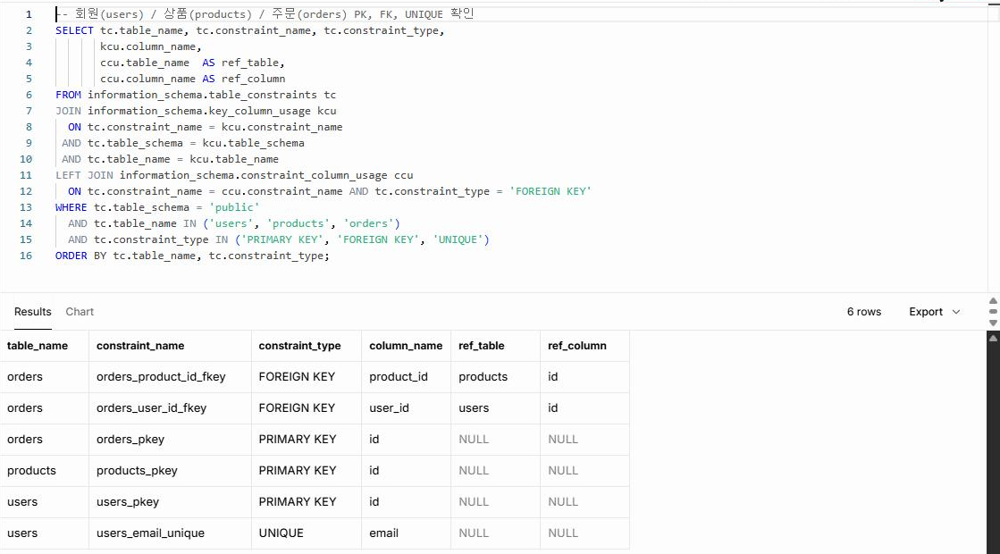
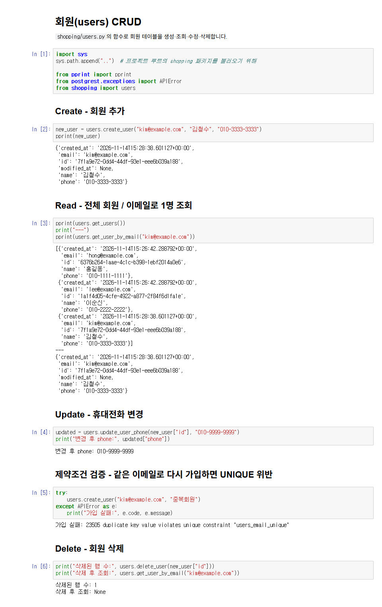
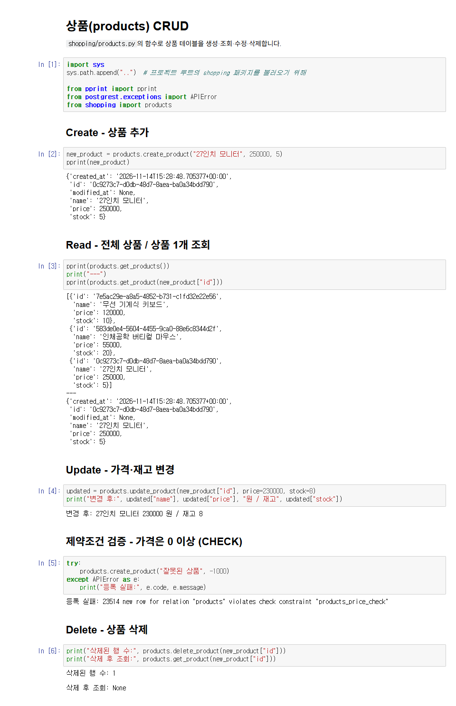
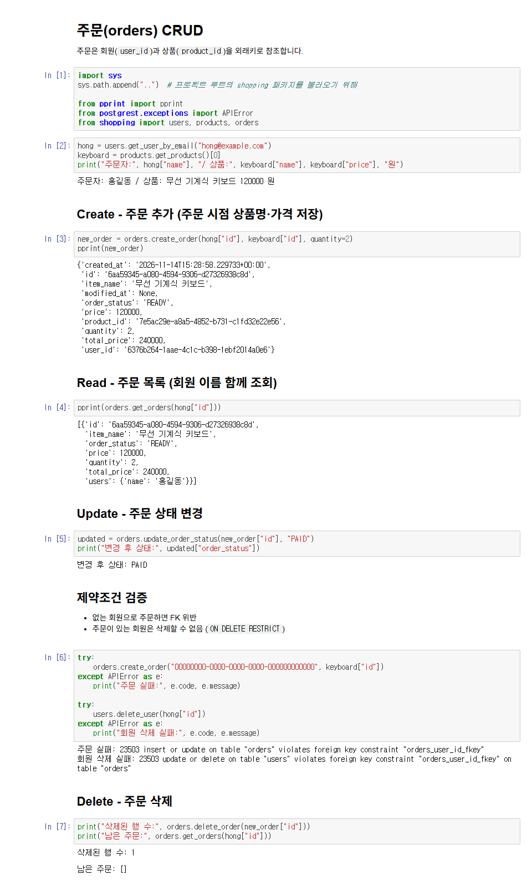
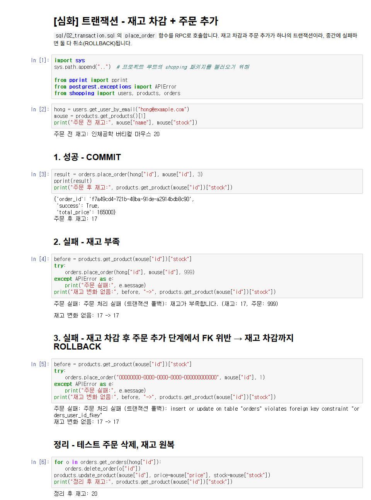

# KANT Supabase Shop

KANT 데이터베이스 & AI 활용 과제입니다. 쇼핑몰의 **회원(users) · 상품(products) · 주문(orders)** 3개 테이블을 Supabase(PostgreSQL)에 설계하고, Python Supabase SDK로 CRUD를 구현했습니다.

## 1. 기술 스택

| 기술 | 용도 |
| --- | --- |
| Python 3.13 / uv | 프로젝트 생성, 가상환경과 의존성 관리 |
| Supabase (PostgreSQL) | 데이터베이스, Data API |
| supabase-py | Python 클라이언트 SDK |
| python-dotenv | `.env`에서 접속 정보 로드 |
| Jupyter (ipykernel) | CRUD 실행 결과 확인 |

## 2. 폴더 구조

```text
KANT_Supabase_Shop/
├── main.py                  # 연결 확인용 진입점
├── shopping/
│   ├── db.py                # .env를 읽어 Supabase 클라이언트 생성
│   ├── users.py             # 회원 CRUD
│   ├── products.py          # 상품 CRUD
│   └── orders.py            # 주문 CRUD + 트랜잭션 함수(RPC) 호출
├── sql/
│   ├── 01_schema.sql        # 테이블 생성 (PK, FK, 제약조건) + 샘플 데이터
│   ├── 02_transaction.sql   # [심화] 주문 트랜잭션 함수 place_order
│   └── 03_rls.sql           # [심화] RLS 정책 (작성 예정)
├── notebooks/               # 테이블별 CRUD 실행 노트북 (실행 결과 저장)
├── docs/images/             # README 캡처
├── .env.example             # 환경 변수 예시
├── pyproject.toml
└── uv.lock
```

## 3. 실행 방법

```bash
uv sync
cp .env.example .env        # SUPABASE_URL, SUPABASE_PUBLISHABLE_KEY 입력
uv run main.py              # 연결 확인
```

1. Supabase SQL Editor에서 `sql/01_schema.sql` → `sql/02_transaction.sql` 순서로 실행합니다.
2. `notebooks/`의 노트북을 커널 `.venv`로 실행합니다.

## 4. 테이블 설계

### 네이밍 규칙

| 대상 | 규칙 | 예시 |
| --- | --- | --- |
| 테이블 | 소문자, 복수형, 스네이크 케이스 | `users`, `products`, `orders` |
| 외래키 컬럼 | `{참조 테이블 단수형}_id` | `user_id`, `product_id` |
| 제약조건 | `{테이블}_{컬럼}_{종류}` | `users_email_unique`, `orders_user_id_fkey` |

### ERD

```mermaid
erDiagram
    users ||--o{ orders : "주문한다"
    products ||--o{ orders : "주문된다"
    users {
        uuid id PK
        text email UK
        text name
        text phone
    }
    products {
        uuid id PK
        text name
        int price
        int stock
    }
    orders {
        uuid id PK
        uuid user_id FK
        uuid product_id FK
        text item_name
        int price
        int quantity
        int total_price
        text order_status
    }
```



### 회원 `users`

| 컬럼 | 타입 | 제약조건 | 설명 |
| --- | --- | --- | --- |
| id | uuid | **PK**, 기본값 `gen_random_uuid()` | 회원 ID |
| email | text | NOT NULL, **UNIQUE** | 이메일 (중복 가입 방지) |
| name | text | NOT NULL | 이름 |
| phone | text | | 휴대전화 |
| created_at | timestamptz | NOT NULL, 기본값 `now()` | 가입일 |
| modified_at | timestamptz | | 수정일 |

### 상품 `products`

| 컬럼 | 타입 | 제약조건 | 설명 |
| --- | --- | --- | --- |
| id | uuid | **PK** | 상품 ID |
| name | text | NOT NULL | 상품명 |
| price | int | NOT NULL, CHECK `price >= 0` | 가격 |
| stock | int | NOT NULL, 기본값 0, CHECK `stock >= 0` | 재고 |
| created_at / modified_at | timestamptz | | 등록일 / 수정일 |

### 주문 `orders`

| 컬럼 | 타입 | 제약조건 | 설명 |
| --- | --- | --- | --- |
| id | uuid | **PK** | 주문 ID |
| user_id | uuid | NOT NULL, **FK → users(id)** ON DELETE RESTRICT | 주문한 회원 |
| product_id | uuid | NOT NULL, **FK → products(id)** ON DELETE RESTRICT | 주문한 상품 |
| item_name | text | NOT NULL | 주문 시점 상품명 (스냅샷) |
| price | int | NOT NULL | 주문 시점 단가 (스냅샷) |
| quantity | int | NOT NULL, CHECK `quantity > 0` | 수량 |
| total_price | int | NOT NULL, CHECK `total_price >= 0` | 결제 금액 |
| order_status | text | CHECK `READY / PAID / SHIPPING / DONE / CANCEL` | 주문 상태 |
| created_at / modified_at | timestamptz | | 주문일 / 수정일 |

- 상품 가격이 나중에 바뀌어도 과거 주문 금액이 변하지 않도록 주문 시점의 상품명·가격을 `orders`에 복사해 둡니다.
- 주문 기록이 있는 회원·상품은 실수로 삭제되지 않도록 `ON DELETE RESTRICT`를 적용했습니다.

### PK / FK 확인 (Supabase SQL Editor)

`information_schema`로 3개 테이블의 PK, FK, UNIQUE 제약조건을 조회한 결과입니다.



## 5. CRUD 동작 화면

`notebooks/`의 노트북을 실행한 결과입니다. 테이블마다 생성 → 조회 → 수정 → 제약조건 검증 → 삭제 순서로 확인했습니다.

### 회원 (`notebooks/01_users_crud.ipynb`)

같은 이메일로 다시 가입하면 `users_email_unique` 위반(23505)으로 실패합니다.



### 상품 (`notebooks/02_products_crud.ipynb`)

음수 가격은 `products_price_check` 위반(23514)으로 등록되지 않습니다.



### 주문 (`notebooks/03_orders_crud.ipynb`)

없는 회원으로 주문하면 FK 위반(23503), 주문이 있는 회원은 `ON DELETE RESTRICT`로 삭제되지 않습니다.



## 6. [심화] 트랜잭션

`sql/02_transaction.sql`의 `place_order` 함수는 **재고 차감 + 주문 추가**를 하나의 트랜잭션으로 처리합니다. Python에서는 `supabase.rpc("place_order", ...)`로 호출합니다.

| 시나리오 | 결과 |
| --- | --- |
| 정상 주문 (수량 3) | COMMIT: 주문 생성, 재고 20 → 17 |
| 재고보다 많이 주문 | 예외 발생, 재고 그대로 |
| 재고 차감 후 없는 회원으로 주문 추가 (FK 위반) | 예외 발생, **이미 차감한 재고까지 ROLLBACK** (17 → 17) |



## 7. 남은 작업

- [ ] [심화] RLS 정책과 사용자 인증 연동 (`sql/03_rls.sql`)
